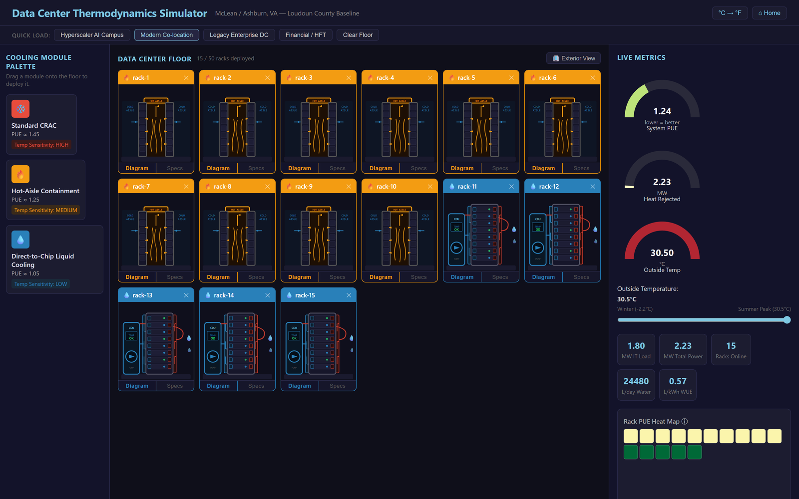
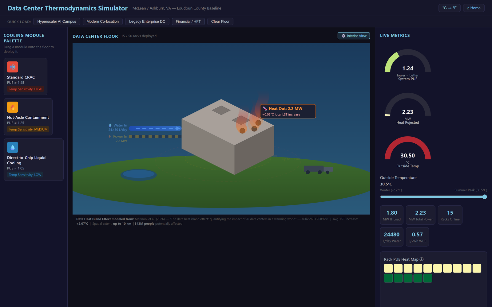

# Data Center Thermodynamics Simulator

[](https://github.com/tnorr99/center_sim/actions/workflows/ci.yml)

**Live demo: [tnorr99.github.io/center_sim](https://tnorr99.github.io/center_sim/)**

This is an interactive model of hyperscale data center energy, water, and
heat. It is based on the Loudoun County, Virginia corridor. You place
NVIDIA GB200 NVL72 racks (120 kW each) on a floor under one of three
cooling strategies and move the outside temperature across the McLean, VA
seasonal range. Facility PUE, power, heat rejection, and water use
recompute on every change.





---

## Features

- **Drag-and-drop racks.** Three cooling types: CRAC (air), hot-aisle
  containment, and direct-to-chip liquid. Each rack's cooling type can be
  changed from a dropdown, and the floor holds up to 50 racks.
- **Presets.** Hyperscaler AI campus, modern co-location, legacy
  enterprise, and financial / HFT.
- **Live metrics.** System PUE, IT load, facility power, heat rejected,
  water use (L/day), and WUE.
- **Seasonal temperature.** A slider covers the McLean, VA range, from the
  winter trough (−2.2 °C) to the summer peak (30.5 °C), with a °C / °F
  toggle. All math runs in °C.
- **D3 visualizations.** Arc gauges for PUE, heat, and temperature, a
  per-rack PUE heat map, and per-rack airflow and coolant diagrams.
- **Exterior view.** Shows power and water inflow, the heat plume, and a
  local land-surface-temperature (LST) estimate based on the data heat
  island effect (see [Heat island](#heat-island-exterior-view)).
- **Explanatory tooltips.** Each metric's tooltip explains its formula
  and what it means in practice.

---

## Model

All of the physics is in `src/logic/thermoCalc.ts`. The functions are pure
and have unit tests.

### PUE per rack

```
PUE(coolingType, T) = baseline + penalty × max(0, T − idealTemp)
```

| Cooling type | Baseline PUE | Ideal temp | Penalty / °C above ideal | PUE at 30.5 °C |
|---|---|---|---|---|
| CRAC (air) | 1.45 | 15 °C | +0.015 | 1.6825 |
| Hot-aisle containment | 1.25 | 22 °C | +0.010 | 1.335 |
| Direct-to-chip liquid | 1.05 | 30 °C | +0.002 | 1.051 |

### Facility metrics

```
totalITLoadMW        = Σ rack.loadMW
totalFacilityPowerMW = Σ rack.loadMW × PUE(rack.coolingType, T)
systemPUE            = totalFacilityPowerMW / totalITLoadMW
heatRejectedMW       = totalFacilityPowerMW     (essentially all power drawn leaves as heat)
```

### Water (WUE)

Water use is load-weighted by cooling type and does not depend on outside
temperature.

| Cooling type | WUE (L per kWh of IT load) |
|---|---|
| CRAC | 0.20 |
| Hot-aisle containment | 0.40 |
| Direct-to-chip liquid | 0.90 (closed-loop DLC plus evaporative heat-rejection make-up) |

```
waterLitersPerDay = Σ rack.loadMW × 1000 × WUE(coolingType) × 24
systemWUE         = waterLitersPerDay / (totalITLoadMW × 1000 × 24)
```

Liquid cooling lowers PUE but raises water use, and the simulator shows
both sides of that trade-off.

### Heat island (exterior view)

The exterior view scales the average land-surface-temperature increase
reported by Marinoni et al. (2026), +2.07 °C, linearly by heat rejected
relative to a 100 MW campus:

```
ΔLST ≈ min(9.1, heatRejectedMW / 100 × 2.07) °C
```

The rings show the paper's reported spatial extent (up to about 10 km).
This is an illustrative first-order scaling, not a spatial climate model.

### Worked example

The Modern Co-location preset is 10 hot-aisle racks and 5 liquid racks,
for 1.80 MW of IT load.

| | 14 °C (annual average) | 30.5 °C (summer peak) |
|---|---|---|
| Facility power / heat rejected | 2.13 MW | 2.23 MW |
| System PUE | 1.18 | 1.24 |
| Water | 24,480 L/day (WUE 0.57) | 24,480 L/day |

These figures are covered by unit tests in `src/tests/`.

---

## Getting started

Requires Node.js 20 or later.

```bash
npm install
npm run dev       # http://localhost:5173
npm test          # 32 unit tests (Vitest)
npm run build     # typecheck + production build to dist/
```

CI (`.github/workflows/ci.yml`) runs on every push and pull request. It
typechecks, runs the tests, runs `npm audit`, and builds the app. Each
push to `main` is deployed to GitHub Pages.

---

## Project structure

```
src/
├── data/
│   ├── constants.json        # Climate, hardware, cooling-profile, and simulation constants
│   └── presets.ts            # Quick-load facility configurations
├── logic/
│   ├── thermoCalc.ts         # PUE, facility, and water (WUE) model
│   ├── store.ts              # Zustand store: racks, temperature, derived metrics
│   └── tempUtils.ts          # °C ↔ °F helpers
├── components/
│   ├── HomePage.tsx          # Landing page and guide
│   ├── CoolingPalette.tsx    # Draggable cooling modules
│   ├── DataCenterFloor.tsx   # Droppable floor, rack diagrams, interior/exterior toggle
│   ├── ExteriorView.tsx      # Isometric exterior: power/water in, heat plume, heat-island rings
│   ├── MetricsDashboard.tsx  # D3 gauges, temperature slider, rack heat map
│   ├── PresetBar.tsx         # Preset buttons
│   └── Tooltip.tsx           # Shared hover tooltip
├── tests/
│   ├── thermoCalc.test.ts    # PUE, facility, and water model
│   └── store.test.ts         # Store actions, rack limit, metric recomputation
├── App.tsx                   # Layout, DndContext, home-page gate
├── App.css
└── main.tsx
docs/
├── BUILD_PROMPT.md           # The agent brief the first version was built from
└── media/                    # README screenshots
```

---

## Data sources

1. **NVIDIA GB200 NVL72.** Blackwell architecture and GB200 NVL72
   technical specifications (2024/2025). Source of the 120 kW per-rack
   power and heat figures.
2. **PUE baselines.** Uptime Institute Annual Global Data Center Survey
   (2023/2024).
3. **Temperature thresholds.** ASHRAE TC 9.9 Environmental Guidelines for
   Datacom Equipment.
4. **WUE.** The Green Grid WUE guidelines and report (2022), Uptime
   Institute WUE benchmarks (2023), and LBNL (2023).
5. **Climate.** NOAA historical climatology, McLean, VA station, used as a
   proxy for Ashburn / Loudoun County.
6. **Heat island.** A. Marinoni et al., "The data heat island effect:
   quantifying the impact of AI data centers in a warming world" (2026),
   [arXiv:2603.20897](https://arxiv.org/abs/2603.20897).

---

## How it was built

The first version was built by directing AI coding agents through a
staged, five-role brief, kept in
[`docs/BUILD_PROMPT.md`](docs/BUILD_PROMPT.md). In that brief the
thermodynamic formulas were supplied as a fixed reference that the agents
were told not to alter. Later work extended the model and the interface:
the WUE model, exterior view, presets, and rack diagrams. It also fixed an
inverted temperature-gauge color scale and enforced the floor's rack
limit, and added store tests.

## License

[MIT](LICENSE)
